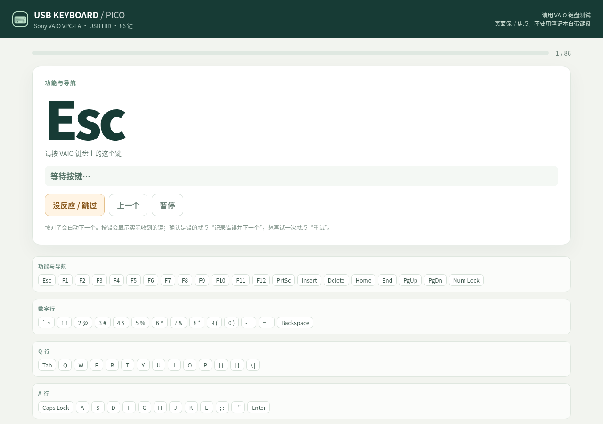
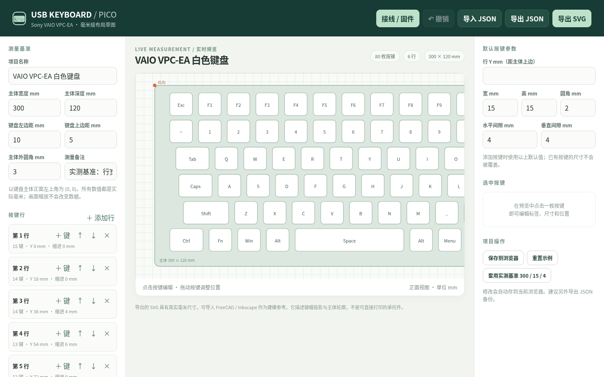
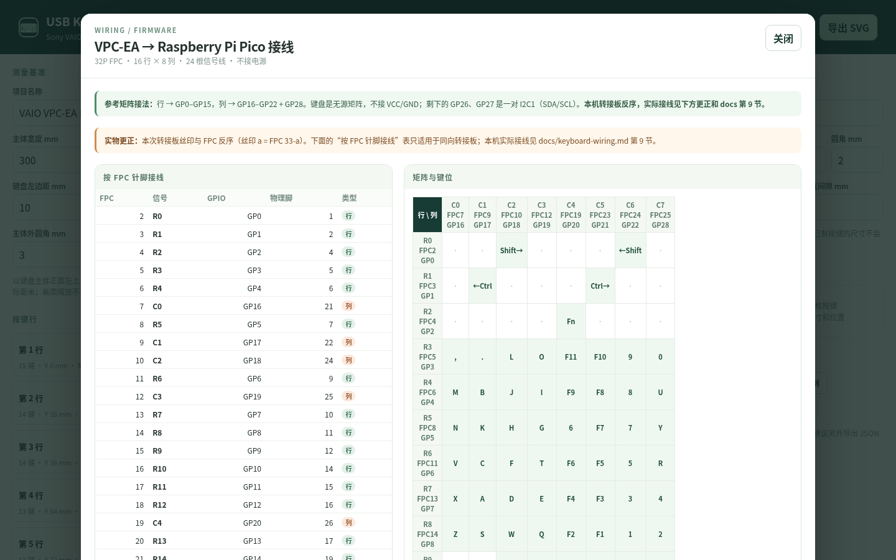

# USB Laptop Keyboard Controller (Pico)

> Frank Adams 的 [USB_Laptop_Keyboard_Controller](https://github.com/thedalles77/USB_Laptop_Keyboard_Controller) 的 **Raspberry Pi Pico / CircuitPython** 版本：Sony VAIO VPC-EA 键盘矩阵逆向、反向 FPC 转接板接线、KMK 固件、86 键逐键测试页和毫米级布局测量页。这个仓库只覆盖键盘控制器本身。

## English summary

A Raspberry Pi Pico port of Frank Adams' USB_Laptop_Keyboard_Controller for the Sony VAIO VPC-EA keyboard. It covers the matrix reverse-engineering, a reversed FPC adapter, CircuitPython + KMK firmware, a browser-based 86-key tester, and a millimetre-accurate keyboard layout tool. This repo is scoped to the keyboard controller only.

## 与上游项目的关系

本仓库沿用 [USB_Laptop_Keyboard_Controller](https://github.com/thedalles77/USB_Laptop_Keyboard_Controller) 的命名和矩阵资料，把原来的 **Teensy 4.0** 参考实现移植到 **Raspberry Pi Pico + CircuitPython + KMK**，并补充了白色 VPC-EA 实物的两个差异：**转接板丝印反序**、**左右 Ctrl 反**。原项目的矩阵 PDF 和 `.ino` 仍然是本仓库的电气参考。

## GitHub 仓库信息

- 仓库名：`USB_Laptop_Keyboard_Controller_Pico`
- 描述：Sony VAIO VPC-EA keyboard → Raspberry Pi Pico USB HID controller, with wiring notes, CircuitPython/KMK firmware, and browser test tools.
- Topics：`keyboard`, `raspberry-pi-pico`, `rp2040`, `circuitpython`, `kmk`, `sony-vaio`, `vpc-ea`, `usb-hid`, `keyboard-controller`, `fpc`

## 当前状态

| 部分 | 状态 |
|---|---|
| 键盘矩阵 / 接线 | ✅ 86 键逐键验证 |
| Pico HID 固件 | ✅ CircuitPython 10.3.2 + KMK |
| 逐键测试页 | ✅ 浏览器直接读 HID，导出 JSON/CSV |
| 键盘布局测绘台 | ✅ 毫米布局、JSON/SVG 导出、接线页 |

## 数据流

```text
Sony VAIO VPC-EA 键盘（32P FPC）
        │ FPC 2–25
        ▼
32P FPC 转 2.54mm 转接板（本机丝印反序）
        │ 24 根信号线
        ▼
Raspberry Pi Pico（CircuitPython + KMK）
        │ USB HID
        ▼
USB 主机（电脑 / 手机）
```

## 界面

### 逐键测试页



### 键盘布局测绘台



### 接线 / 固件页



## 硬件

### 键盘

- Sony VAIO VPC-EA **白色美式** 86 键内置键盘。
- 商品/替换件料号：`148792421`、`012-101A-3201-A`、`550102L05-203-G`。
- 32 针 FPC，**1 针和 26–32 针为 NC**，实际使用 2–25 针。
- 16 行 × 8 列，86 个按键。
- **没有背光**，FPC 里没有键盘电源；不要给矩阵接 VCC/GND。

### 电气参考件

- 料号 **A-1765-621-A**（黑色美式），开源资料来自 Frank Adams 的
  [USB_Laptop_Keyboard_Controller](https://github.com/thedalles77/USB_Laptop_Keyboard_Controller)。
- 矩阵 PDF：[Sony Vaio VPCEA Keyboard A-1765-621-A Matrix.pdf](https://github.com/thedalles77/USB_Laptop_Keyboard_Controller/blob/master/Example_Keyboards/Sony_Vaio_VPCEA/Sony%20Vaio%20VPCEA%20Keyboard%20A-1765-621-A%20Matrix.pdf)
- 原参考固件：[Sony_VPCEA_Keyboard_4p0.ino](https://github.com/thedalles77/USB_Laptop_Keyboard_Controller/blob/master/Example_Keyboards/Sony_Vaio_VPCEA/Sony_VPCEA_Keyboard_4p0.ino)

白色键盘的按键矩阵与参考件基本兼容，但本机制作过程中有两个差异：

1. **所用转接板丝印与 FPC 针号反序**（不是键盘本身的问题，是本机遇到的最大坑）。
2. **左/右 Ctrl 在实物上与参考件相反**，固件里已对调。

### 控制器

- Raspberry Pi Pico（RP2040，2MB Flash），标准 40 针排针。
- 实测固件：CircuitPython **10.3.2** + KMK **main（2026-11 快照）**。
- Pico W / Pico 2 的 40 针顺序相同，理论可用，未实测。

### FPC 转接板

- 32P FPC 转 2.54mm 排针、带锁扣的转接板。
- **买来先量通断，不要相信丝印方向。** 本机丝印 `a` 对应 FPC `33-a`，也就是 26–32 的空脚在一端，实际 FPC 2 在丝印 31。
- 如果转接板是同向的，直接用 `docs/keyboard-wiring-reference.md` 里的按 FPC 针号表；本机的反向接法见下面。
- 部分座子需要修掉 FPC 1 针附近的塑料才能插到底（原作者的就是）；**本机座子不修剪也能用**。先空插确认，不要默认修剪。

## 接线

### 反向转接板实物接法

现有 18 根线接在转接板丝印 **8–25**，实际承载 FPC **25–8**；FPC **2–7** 需要从丝印 **26–31** 补线。Pico 端保持“丝印 a → G(a)”不变。

| 转接板丝印 | Pico GPIO | 物理脚 | 实际 FPC | 逻辑 | 说明 |
|---:|---:|---:|---:|---|---|
| 8 | GP5 | 7 | FPC 25 | C7 | 原有 |
| 9 | GP17 | 22 | FPC 24 | C6 | 原有 |
| 10 | GP18 | 24 | FPC 23 | C5 | 原有 |
| 11 | GP6 | 9 | FPC 22 | R15 | 原有 |
| 12 | GP19 | 25 | FPC 21 | R14 | 原有 |
| 13 | GP7 | 10 | FPC 20 | R13 | 原有 |
| 14 | GP8 | 11 | FPC 19 | C4 | 原有 |
| 15 | GP9 | 12 | FPC 18 | R12 | 原有 |
| 16 | GP10 | 14 | FPC 17 | R11 | 原有 |
| 17 | GP11 | 15 | FPC 16 | R10 | 原有 |
| 18 | GP12 | 16 | FPC 15 | R9 | 原有 |
| 19 | GP20 | 26 | FPC 14 | R8 | 原有 |
| 20 | GP13 | 17 | FPC 13 | R7 | 原有 |
| 21 | GP14 | 19 | FPC 12 | C3 | 原有 |
| 22 | GP15 | 20 | FPC 11 | R6 | 原有 |
| 23 | GP21 | 27 | FPC 10 | C2 | 原有 |
| 24 | GP22 | 29 | FPC 9 | C1 | 原有 |
| 25 | GP28 | 34 | FPC 8 | R5 | 原有 |
| 26 | GP16 | 21 | FPC 7 | C0 | 新线 |
| 27 | GP4 | 6 | FPC 6 | R4 | 新线 |
| 28 | GP3 | 5 | FPC 5 | R3 | 新线 |
| 29 | GP2 | 4 | FPC 4 | R2 | 新线 |
| 30 | GP1 | 2 | FPC 3 | R1 | 新线 |
| 31 | GP0 | 1 | FPC 2 | R0 | 新线 |

丝印 **1 和 32** 分别对应 FPC 32/1，都是 NC，不接。

如果你已经按 FPC 同向表把线接在丝印 2–7，最省事的修法是把这 6 根从丝印 **2–7 挪到 31–26**，Pico 端不动：

| 现在 | 挪到 | Pico 端 |
|---|---|---|
| 2 | 31 | GP0 |
| 3 | 30 | GP1 |
| 4 | 29 | GP2 |
| 5 | 28 | GP3 |
| 6 | 27 | GP4 |
| 7 | 26 | GP16 |

### 安全

- RP2040 GPIO 是 **3.3V 逻辑，不耐 5V**。
- 键盘是**无源开关矩阵**，不需要 VCC/GND；不要把 3.3V 或 5V 接到矩阵线。
- 不要热插拔 FPC；插拔前断电。
- 先做通断测试，再上电。重点核对 Q（FPC14+12）、Space（FPC15+10）、Esc（FPC15+23）、←（FPC21+7）、Backspace（FPC22+24）。

更多细节：[docs/keyboard-wiring.md](docs/keyboard-wiring.md)。

## 固件

工作固件：[firmware/main.py](firmware/main.py)。

### 扫描方式

照原版 `Sony_VPCEA_Keyboard_4p0.ino`：

1. 8 根列线设为**上拉输入**。
2. 16 根行线逐根拉低，其余行保持**高阻**。
3. 读列线：低 = 该键按下。
4. 扫描完一行把行线恢复高阻。

### 为什么不直接用 KMK 默认扫描

KMK 默认的 `keypad.MatrixScanner` 是**正逻辑/下拉**扫描；这块笔记本薄膜键盘是**负逻辑/上拉**。直接用默认扫描会出现“能读到一部分、但大量键没反应”的假象。所以 `main.py` 里写了一个很小的 `VpceaScanner`，完全照原版方式扫描并返回 `keypad.Event`。

### 两个 KMK 坑

1. **keymap 必须是扁平列表**：KMK 的 `keymap[layer][idx]` 直接按 `row * cols + col` 取键，不是二维嵌套。`main.py` 里是 128 项扁平 keymap。
2. **`KC.APPLICATION` 在基础 KMK 里不存在**：Menu 键用 `KeyboardKey(code=101)` 手动定义，或者启用 international 扩展。

### 实物修正

- **左/右 Ctrl 对调**：keymap 在 R1C1 / R1C5 交换了 `KC.LCTRL` / `KC.RCTRL`。
- **Fn 媒体层**：Fn 是 `KC.MO(1)`，第 1 层已实现：
  - Fn+F2 静音
  - Fn+F3 音量减
  - Fn+F4 音量加
  - Fn+Insert Pause
  - Fn+NumLock Scroll Lock

### 烧录

1. 给 Pico 刷 CircuitPython（按住 BOOTSEL 上电，拖入官方 `raspberry_pi_pico` UF2）。
2. 把 KMK 的 `kmk/` 目录复制到 `CIRCUITPY/` 根目录。
3. 把 [firmware/main.py](firmware/main.py) 复制成 `CIRCUITPY/main.py`。
4. 如果根目录有 `code.py`，删掉或改名，避免它优先运行。
5. USB 接电脑，用逐键测试页验证。

固件说明：[firmware/README.md](firmware/README.md)。

## 网页工具

### 1. 逐键测试页

[keyboard-test/index.html](keyboard-test/index.html)

- 浏览器监听 Pico 发来的 HID `keydown`，一次显示一个键。
- 按对自动下一个；按错显示实际收到的 `event.code`；没反应点“没反应 / 跳过”。
- 结果自动保存在 localStorage，可导出 JSON/CSV。
- Fn 单独按没有 HID，直接跳过；PrtSc/Win/Alt 可能被系统截获，没反应就跳过。

本地打开：

```bash
cd keyboard-test
python3 -m http.server 8765
# 浏览器打开 http://127.0.0.1:8765/
```

### 2. 键盘布局测绘台

[keyboard-measure/dist/index.html](keyboard-measure/dist/index.html)

- 按毫米录入主体尺寸、行、按键宽高/间距/圆角。
- 实时预览，导出 JSON 和真实毫米尺寸的 SVG（可进 FreeCAD / Inkscape）。
- 右上角“接线 / 固件”页包含 FPC 接线表、矩阵图和固件下载。

本地打开：

```bash
cd keyboard-measure/dist
python3 -m http.server 8766
# 浏览器打开 http://127.0.0.1:8766/
```

## 复现步骤

1. 准备键盘、32P FPC 转接板、Pico、杜邦线/细线、万用表。
2. 量转接板方向：丝印 `a` 和 FPC 针号是否同向。**不要默认同向。**
3. 按上面的反向表接线；FPC 只接 2–25，1 和 26–32 不接。
4. 用通断档验证 5 组键（Q/Space/Esc/←/Backspace）。
5. 刷 CircuitPython，复制 `kmk/` 和 `firmware/main.py`。
6. 打开逐键测试页，跑完 86 键；按结果修 keymap。

## 踩坑清单

1. **转接板丝印可能是反的。** 本机 `a = 33-a`，导致 FPC 2–7 全部开路、其余线序全反；表现是“部分键能用、但大量键没反应/错位”。
2. **FPC 2–7 在 pin 1 端。** 本机的 FPC 2–7 失联是转接板反序导致这几根线根本没接，不是排线没插到底。部分座子（包括原作者用的座子）需要修掉 pin 1 附近塑料才能插到底；本机座子不修剪也能用，先确认能不能插到底再决定是否修剪。
3. **KMK 默认扫描是正逻辑。** 这块键盘是负逻辑上拉，必须用自定义扫描或 `digitalio.MatrixScanner` + `Pull.UP`。
4. **KMK keymap 是扁平的。** 二维嵌套不会报错，但取出来的是“一行列表”，键盘不出字。
5. **`KC.APPLICATION` 不在基础 KMK。** Menu 键要手动定义或用 international 扩展。
6. **左/右 Ctrl 与参考件相反。** 在 keymap 里对调即可。
7. **Fn 不是 HID 键。** 单独按不会有任何输出，必须做成 layer。
8. **PrtSc 常被桌面截屏占用。** 浏览器测试页看不到它，不代表键坏了。
9. **调试打印会堵 USB 串口。** 扫描循环里 `print` 如果没有主机读串口，可能把缓冲填满，反而让键盘卡住；生产固件不要打印。
10. **浏览器分不清两块键盘。** 测试时必须只用目标键盘，并保持页面焦点；Alt/Win 可能把焦点抢走。

## 仓库结构

```text
.
├── README.md
├── docs/
│   ├── keyboard-vpcea.md              # 键盘型号/机械尺寸调查
│   ├── keyboard-wiring.md             # 工作接线文档（含反向转接板第 9 节）
│   ├── keyboard-wiring-reference.md   # 按 FPC 针号的参考表（生成物）
│   ├── project-notes.md               # 详细调试笔记与决策过程
│   └── images/                        # README 截图
├── firmware/
│   ├── main.py                        # 工作固件（CircuitPython + KMK）
│   ├── README.md
│   ├── keymap.csv                     # 参考矩阵键位表
│   └── keyboard-wiring-reference.csv  # 参考接线表
├── keyboard-test/
│   ├── index.html                     # 86 键逐键测试页
│   └── README.md
├── keyboard-measure/
│   ├── dist/index.html                # 毫米布局测绘台
│   └── README.md
└── tools/
    └── gen_keyboard_wiring.py         # 参考表生成器（不覆盖工作固件）
```

> `keyboard-measure/` 里原来有一个嵌套的 `.git` 和 OpenAI Sites 的 `.openai/hosting.json`。上传 GitHub 前建议删掉 `.git`（或改成 submodule），`.openai/` 如果不用 Sites 部署也可以删。`aurora-keyboard-site-v*.tar.gz` 是本地打包产物，不建议提交。

### 上传 GitHub 前

```bash
# 1. 处理嵌套仓库（最简单：删除子目录里的 .git；想保留历史可改用 git subtree）
rm -rf keyboard-measure/.git

# 2. 删掉本地打包产物和不需要的部署元数据
rm -f aurora-keyboard-site-v*.tar.gz
rm -rf keyboard-measure/.openai

# 3. 在项目根目录初始化并提交
git init -b main
git add .
git commit -m "USB Laptop Keyboard Controller (Pico): VPC-EA + Pico HID"
```

## 下一步

- Fn 亮度/无线开关等组合（需要看键帽图标，当前只实现了原版 media 矩阵里的五个）。
- 如果换用同向转接板，按 `docs/keyboard-wiring-reference.md` 接线，并把固件行/列 GPIO 改回同向表。
- 其他 VPC-EA 变体 / 其他笔记本键盘的矩阵适配。
- 可选：QMK 端口，或把 Pico 换成其他 RP2040 板。

## 参考与致谢

- Frank Adams / [thedalles77/USB_Laptop_Keyboard_Controller](https://github.com/thedalles77/USB_Laptop_Keyboard_Controller)：VPC-EA 矩阵 PDF 和原 Teensy 参考固件（Apache-2.0）。
- [KMK Firmware](https://github.com/KMKfw/kmk_firmware)：RP2040/CircuitPython 键盘固件框架。
- [Adafruit CircuitPython](https://circuitpython.org/)：Pico 固件与 `usb_hid`。
- [Raspberry Pi Pico 文档](https://www.raspberrypi.com/documentation/microcontrollers/pico-series.html)。
- 键盘布局工具参考：[Keyboard Layout Editor](https://github.com/ijprest/keyboard-layout-editor)、[Ergogen](https://github.com/ergogen/ergogen)。

## License

本仓库的代码和文档使用 **Apache-2.0**，见 [LICENSE](LICENSE)。参考矩阵和原 Teensy 固件来自 Frank Adams 的 [USB_Laptop_Keyboard_Controller](https://github.com/thedalles77/USB_Laptop_Keyboard_Controller)，同样是 Apache-2.0。
